**English** · [Português](README.pt-BR.md)

<a id="top"></a>

<p align="center">
  <picture>
    <source media="(max-width: 600px) and (prefers-color-scheme: dark)" srcset="assets/en/hero-narrow-dark.svg" />
    <source media="(max-width: 600px)" srcset="assets/en/hero-narrow-light.svg" />
    <source media="(prefers-color-scheme: dark)" srcset="assets/en/hero-dark.svg" />
    
  </picture>
</p>

<h1 align="center">harness-review</h1>

<p align="center"><strong>Find what your AI does that code should do.</strong></p>

<p align="center">A <strong>Claude Code</strong> skill that reviews a routine, a skill or a project step by step and says, for each step, whether the AI, a person or code should do it, with what each change saves and what it loses. Every number comes from your own past runs, read from your local transcripts. It reads only and writes one report.</p>

<p align="center">
  <a href="LICENSE"></a>
  
  
</p>

<p align="center"><a href="#install"><strong>Install</strong></a> · <a href="#how-it-works">How it works</a> · <a href="#first-run">First run</a> · <a href="#never">What it never does</a> · <a href="#local-rules">Local rules</a> · <a href="#requirements">Requirements</a></p>

<a id="install"></a>

## Install

Open **Claude Code** in any folder and paste this request.
It adds this repository as a plugin marketplace, installs the plugin from it, and tells you when to restart.

```text
Install the harness-review plugin from https://github.com/felipevdc1/harness-review. Run /plugin marketplace add felipevdc1/harness-review and then /plugin install harness-review@harness-review. If the marketplace is already added, run /plugin marketplace update harness-review first. Confirm the plugin is listed as enabled and tell me when to restart Claude Code.
```

<p align="center">
  <picture>
    <source media="(prefers-color-scheme: dark)" srcset="assets/en/install-dark.svg" />
    
  </picture>
</p>

When it finishes, restart Claude Code and call **`/harness-review:harness-review`**, or just ask "review &lt;my routine&gt; for what should be code".

<details>
<summary><strong>Install from the terminal</strong></summary>

```sh
claude plugin marketplace add felipevdc1/harness-review
claude plugin install harness-review@harness-review
```

Update later with `claude plugin marketplace update harness-review` and then `claude plugin update harness-review@harness-review`.

**Private repository.** While the repository is private, Claude Code clones it with your machine's own git credentials.
If the add step fails to clone, run `gh auth setup-git` once and try again.

**Manual copy, no plugin system.** Copy the skill folder into your personal skills:

```sh
git clone https://github.com/felipevdc1/harness-review.git
cp -R harness-review/skills/harness-review ~/.claude/skills/
```

Every path inside the skill goes through `${CLAUDE_SKILL_DIR}`, so the copy works the same way; call it as `/harness-review`.
Keep only one of the two installs, or you will see the skill twice.

</details>

<a id="how-it-works"></a>

## How it works

<p align="center">
  <picture>
    <source media="(max-width: 600px) and (prefers-color-scheme: dark)" srcset="assets/en/how-it-works-narrow-dark.svg" />
    <source media="(max-width: 600px)" srcset="assets/en/how-it-works-narrow-light.svg" />
    <source media="(prefers-color-scheme: dark)" srcset="assets/en/how-it-works-dark.svg" />
    
  </picture>
</p>

1. **You name a target**: a routine, a skill, a folder or a process in the current project.
2. **The skill reads its method**, `skills/harness-review/METHOD.md`, whole, every time, and walks its steps on the target: the state of now, the list of steps, the measure, the decision per step, and what each change saves and loses.
3. **Every run number comes from the reader**, `skills/harness-review/reader/mede.py`, which reads your Claude Code transcripts on your machine (standard library only). The session doing the review is kept out of its own numbers. What cannot be measured is written as "not measured", never guessed.
4. **You get one report** in `./harness-reviews/<date>-<target>.md`, in your own language: per step, AI, person, code or a mix, with the evidence, the exact reader commands it ran, and a test that should fail today for each step that should become code.

Nothing is built. Each item turns into a task or a plan only on your yes, with whatever tool you use.

<a id="first-run"></a>

## First run on the example

The repository ships a synthetic target, `examples/daily-digest`: a scheduled prompt, `[routine] build the daily digest`, asks the AI every morning to read `inbox.json`, sort the items by a fixed priority field and write `digest.md`.
Seven days of made-up runs of it live in `examples/transcripts/-example`.

Open Claude Code in the cloned repository and ask:

```text
/harness-review:harness-review review examples/daily-digest with the transcripts in examples/transcripts/-example, window 2026-11-01 to 2026-11-07
```

The report should flag the priority sort as work for code: a fixed-field decision the AI is redoing every morning.

<p align="center">
  <picture>
    <source media="(prefers-color-scheme: dark)" srcset="assets/en/report-dark.svg" />
    
  </picture>
</p>

<a id="never"></a>

## What it never does

- It never builds, edits or runs anything that changes the target.
- It writes one file: the report.
- It reads transcripts locally and sends nothing anywhere.
- It never invents a number: a run count, a median or a cost either comes from the reader's output, quoted with its command, or the report says it was not measured.
- It never turns an item into a task or a plan without your yes.

<a id="local-rules"></a>

## Local rules

Point the environment variable `HARNESS_REVIEW_LOCAL` at a markdown file of your own, and the skill reads it whole before anything else.
That file can set where reports go, how a target name is resolved in your setup, extra boundaries, opener shapes of your own routines, and which tool receives a task or a plan.
Set it in your machine-local Claude Code settings, for example `.claude/settings.local.json`:

```json
{ "env": { "HARNESS_REVIEW_LOCAL": "/path/to/my-review-rules.md" } }
```

If the variable names a file that does not exist, the skill says so in one line and uses its defaults.

<a id="requirements"></a>

## Requirements

| Requirement | What works |
|---|---|
| Claude Code | With plugin support (`/plugin`) |
| Python | 3.9+, standard library only (the stock macOS `python3` works) |
| Operating system | macOS and Linux, tested |
| Windows | Expected to work (call `python` instead of `python3`), not tested |
| pytest | Only to run the tests |

<details>
<summary><strong>Run the tests</strong></summary>

```sh
uv run --with pytest python -B -m pytest -q tests
```

Without uv: `python -m pip install pytest`, then `python -B -m pytest -q tests`.
The reader's own manual, with every flag and answer key, is `skills/harness-review/reader/README.md`.

</details>

## Credits

The transcript reader re-implements rules from Anthropic's [session-report plugin](https://github.com/anthropics/claude-plugins-official/tree/main/plugins/session-report) (`analyze-sessions.mjs`, Apache-2.0): the model-call key, keeping the usage with the largest output per key, the sub-agent type from the file name, and reading files in first-timestamp order.
They are re-implemented in Python and extended; see [NOTICE](NOTICE).
The public sources the method's rules rest on are listed in [METHOD.md](skills/harness-review/METHOD.md), under "Sources".

## License

[Apache-2.0](LICENSE). See [NOTICE](NOTICE) for attribution.

Made by Felipe Carneiro: GitHub [felipevdc1](https://github.com/felipevdc1) · Instagram [@o.felipecarneiro](https://instagram.com/o.felipecarneiro).
