[English](README.md) · **Português**

<a id="top"></a>

<p align="center">
  <picture>
    <source media="(prefers-color-scheme: dark)" srcset="assets/hero-dark.svg" />
    
  </picture>
</p>

<h1 align="center">harness-review</h1>

<p align="center"><strong>Descubra o que a sua IA faz que devia ser código.</strong></p>

<p align="center">Uma skill do <strong>Claude Code</strong> que revisa uma rotina, uma skill ou um projeto passo a passo e diz, em cada passo, se quem devia fazer é a IA, uma pessoa ou o código, com o que cada mudança economiza e o que ela perde. Todo número vem das suas próprias execuções passadas, lidas das transcrições locais. Ela só lê e escreve um relatório.</p>

<p align="center">
  <a href="LICENSE"></a>
  
  
</p>

<p align="center"><a href="#instalar"><strong>Instale com um pedido</strong></a> · <a href="#como-funciona">Como funciona</a> · <a href="#primeira-vez">Primeira vez</a> · <a href="#nunca">O que ela nunca faz</a> · <a href="#regras-locais">Regras locais</a> · <a href="#requisitos">Requisitos</a></p>

<a id="instalar"></a>

## Instale com um pedido

Abra o **Claude Code** em qualquer pasta e cole este pedido.
Ele adiciona este repositório como marketplace de plugins, instala o plugin a partir dele e avisa quando reiniciar.

```text
Instale o plugin harness-review de https://github.com/felipevdc1/harness-review. Rode /plugin marketplace add felipevdc1/harness-review e depois /plugin install harness-review@harness-review. Se o marketplace já estiver adicionado, rode antes /plugin marketplace update harness-review. Confirme que o plugin aparece como ativado e me diga quando reiniciar o Claude Code.
```

Quando terminar, reinicie o Claude Code e chame **`/harness-review:harness-review`**, ou só peça "revisa &lt;minha rotina&gt;" ou "o que aqui devia ser código".

<details>
<summary><strong>Prefere o terminal?</strong></summary>

```sh
claude plugin marketplace add felipevdc1/harness-review
claude plugin install harness-review@harness-review
```

Para atualizar depois: `claude plugin marketplace update harness-review` e em seguida `claude plugin update harness-review@harness-review`.

**Repositório privado.** Enquanto o repositório for privado, o Claude Code o clona com as credenciais de git da sua própria máquina.
Se a etapa de adicionar não conseguir clonar, rode `gh auth setup-git` uma vez e tente de novo.

**Cópia manual, sem o sistema de plugins.** Copie a pasta da skill para as suas skills pessoais:

```sh
git clone https://github.com/felipevdc1/harness-review.git
cp -R harness-review/skills/harness-review ~/.claude/skills/
```

Todo caminho dentro da skill passa por `${CLAUDE_SKILL_DIR}`, então a cópia funciona do mesmo jeito; chame como `/harness-review`.
Fique com só uma das duas instalações, senão a skill aparece duas vezes.

</details>

<a id="como-funciona"></a>

## Como funciona

<p align="center">
  <picture>
    <source media="(prefers-color-scheme: dark)" srcset="assets/how-it-works-dark.svg" />
    
  </picture>
</p>

1. **Você nomeia um alvo**: uma rotina, uma skill, uma pasta ou um processo do projeto atual.
2. **A skill lê o método dela**, `skills/harness-review/METHOD.md`, inteiro, toda vez, e percorre os passos no alvo: o estado de agora, a lista de passos, a medida, a decisão em cada passo e o que cada mudança economiza e perde.
3. **Todo número de execução vem do leitor**, `skills/harness-review/reader/mede.py`, que lê as suas transcrições do Claude Code na sua máquina (só biblioteca padrão). A sessão que faz a revisão fica fora dos próprios números. O que não dá para medir sai escrito como "não medido", nunca chutado.
4. **Você recebe um relatório** em `./harness-reviews/<data>-<alvo>.md`, na sua língua: em cada passo, IA, pessoa, código ou uma mistura, com a evidência, os comandos exatos do leitor que ela rodou e, para cada passo que devia virar código, um teste que hoje falharia.

Nada é construído. Cada item só vira tarefa ou plano com o seu sim, na ferramenta que você usa.

<a id="primeira-vez"></a>

## Primeira vez, no exemplo

O repositório traz um alvo inventado, `examples/daily-digest`: um pedido agendado, `[routine] build the daily digest`, manda a IA, toda manhã, ler `inbox.json`, ordenar os itens por um campo fixo de prioridade e escrever `digest.md`.
Sete dias de execuções inventadas dele estão em `examples/transcripts/-example`.

Abra o Claude Code no repositório clonado e peça:

```text
/harness-review:harness-review revisa examples/daily-digest com as transcrições em examples/transcripts/-example, janela de 2026-11-01 a 2026-11-07
```

O relatório deve apontar a ordenação por prioridade como trabalho de código: uma decisão por campo fixo que a IA refaz toda manhã.

<a id="nunca"></a>

## O que ela nunca faz

- Nunca constrói, edita ou roda nada que mude o alvo.
- Escreve um arquivo só: o relatório.
- Lê as transcrições localmente e não manda nada para lugar nenhum.
- Nunca inventa número: uma contagem de execuções, uma mediana ou um custo ou vem da resposta do leitor, citada com o comando, ou o relatório diz que não foi medido.
- Nunca transforma um item em tarefa ou plano sem o seu sim.

<a id="regras-locais"></a>

## Regras locais

Aponte a variável de ambiente `HARNESS_REVIEW_LOCAL` para um arquivo markdown seu, e a skill o lê inteiro antes de tudo.
Esse arquivo pode definir onde os relatórios ficam, como o nome de um alvo é resolvido no seu ambiente, limites a mais, os formatos de abertura das suas próprias rotinas e qual ferramenta recebe uma tarefa ou um plano.
Defina a variável nas configurações locais do Claude Code da sua máquina, por exemplo `.claude/settings.local.json`:

```json
{ "env": { "HARNESS_REVIEW_LOCAL": "/caminho/para/minhas-regras-de-revisao.md" } }
```

Se a variável apontar para um arquivo que não existe, a skill avisa em uma linha e usa o padrão.

<a id="requisitos"></a>

## Requisitos

| Você vai precisar de | Versão |
|---|---|
| Claude Code | Com suporte a plugins (`/plugin`) |
| Python | 3.10+, só biblioteca padrão |
| Sistema operacional | macOS e Linux, testados |
| Windows | Deve funcionar (chame `python` em vez de `python3`), não testado |
| pytest | Só para rodar os testes |

<details>
<summary><strong>Rodar os testes</strong></summary>

```sh
uv run --with pytest python -B -m pytest -q tests
```

Sem uv: `python -m pip install pytest` e depois `python -B -m pytest -q tests`.
O manual do leitor, com cada opção e cada chave da resposta, é `skills/harness-review/reader/README.md` (em inglês).

</details>

## Créditos

O leitor de transcrições reimplementa regras do [plugin session-report](https://github.com/anthropics/claude-plugins-official/tree/main/plugins/session-report) da Anthropic (`analyze-sessions.mjs`, Apache-2.0): a chave de cada chamada ao modelo, guardar o uso com a maior saída por chave, o tipo de subagente pelo nome do arquivo e ler os arquivos na ordem do primeiro horário.
Elas foram reimplementadas em Python e ampliadas; veja o [NOTICE](NOTICE).
As fontes públicas em que as regras do método se apoiam estão no [METHOD.md](skills/harness-review/METHOD.md), em "Sources".

## Licença

[Apache-2.0](LICENSE). Veja o [NOTICE](NOTICE) para a atribuição.

<p align="center"><a href="#top">Voltar ao topo ↑</a></p>

Feito por Felipe Carneiro: GitHub [felipevdc1](https://github.com/felipevdc1) · Instagram [@o.felipecarneiro](https://instagram.com/o.felipecarneiro).
